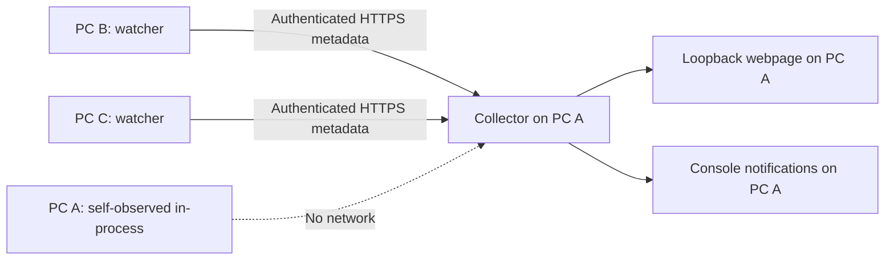

# Copilot session monitor for Windows

A standalone, metadata-only dashboard for Copilot work on **explicitly paired Windows PCs** on a shared LAN or VPN. One collector PC shows a dashboard and console notifications; each additional PC runs a lightweight watcher that reports to it. No cloud relay, accounts, or service install — just `uv run`.

## Quick start

### Host machine (the PC that shows the dashboard)

```powershell
git clone https://github.com/rchiodo/copilot-session-monitor.git
cd copilot-session-monitor
uv run start-host.py --lan
```

This opens the dashboard at **http://127.0.0.1:43187** and immediately shows this machine's own Copilot sessions. At the console menu, press `3` (**Generate connection request**) for each additional PC you want to pair, and copy the printed `csm1:...` connection string.

> Only ever going to run on this one machine? Use `uv run start-tray.py --host` instead and skip `--lan`.

### Client machine (every other PC)

```powershell
git clone https://github.com/rchiodo/copilot-session-monitor.git
cd copilot-session-monitor
uv run start-tray.py
```

At the console menu, press `1` (**Connect to host**), paste the connection string from the host, and press Enter. This PC now reports its Copilot sessions to the host's dashboard.

### Stopping

```powershell
uv run stop-host.py     # on the host
uv run stop-client.py   # on a client
```

## Requirements

- Windows 10/11, [`uv`](https://docs.astral.sh/uv/) on `PATH` (no separate `pip install` step).
- A supported local Copilot installation (`%USERPROFILE%\.copilot`) on each watcher PC.
- An existing LAN/VPN route between the PCs; this app doesn't configure networking or firewalls itself.

<details>
<summary><b>How it works</b></summary>



Each role is a single Python process attached to its own console, with a numbered menu (type a digit, `?` to reprint). The **watcher** reads only its own machine's Copilot metadata/events and posts bounded status to the collector. The **collector** receives reports, serves the dashboard, and owns notifications/dismissal — it never opens a remote Copilot database or filesystem.

For a different dashboard/ingestion port, set `$env:MONITOR_PORT` / pass a port to `init-host.py`. Self-observation (the collector watching its own machine automatically) can be disabled with `$env:MONITOR_SELF_OBSERVE = '0'`.

</details>

<details>
<summary><b>Trust, credentials, and network boundaries</b></summary>

- HTTPS is mandatory, including for local reports. The self-signed certificate is created in memory and stored only under `.local` — never installed into the Windows trust store.
- Each credential can connect/report/disconnect only its own reporter identity; it cannot read other reporters, change collector config, or stop the collector.
- The collector only ever binds a user-selected private/loopback interface. No automatic firewall, certificate-store, OS startup, or VPN changes are made.
- To revoke a remote credential (its reporter ID is in the dashboard details or the private pairing file):
  ```powershell
  python -m pymonitor.cli config revoke REPORTER-ID
  ```

</details>

<details>
<summary><b>Reading the dashboard</b></summary>

Two columns — **Running** and **Finished / Needs input** (which also covers **Error**, **Interrupted**, and **Unconfirmed**). Each card is one canonical parent session plus its linked descendants on that source, showing the machine name, title, state, and last-response time; expand a card for full titles, nested status, and timestamps. A status banner only appears when something needs attention (unhealthy collector or failed notifications) — it's hidden in the normal "everything's fine" state.

**Dismiss**/**Clear retained** hide a finished or unconfirmed entry from the list without touching any real Copilot data; working/error/offline families can't be dismissed. Use **Test notification** (webpage button or console menu `2`) to confirm the notification pipeline — alerts print to the collector's console, not as Windows toast popups.

</details>

<details>
<summary><b>Protocol, sources, and privacy</b></summary>

Watchers report roughly every 1.5 seconds over authenticated HTTPS (`/v1/connect`, `/v1/report`, `/v1/disconnect`); missing heartbeats for 15 seconds mark a family **Unconfirmed** rather than assuming it finished. Each watcher reads only its own `%USERPROFILE%\.copilot\data.db` and `events.jsonl`, read-only — only bounded lifecycle metadata (session IDs/titles, status, timestamps) ever leaves the machine. No prompts, response text, commands, tool output, or file contents are transmitted, and no session UI scraping or Copilot auth tokens are used.

Private keys, pairing files, and retained metadata live under Git-ignored `.local\` — never publish those files.

</details>

<details>
<summary><b>Troubleshooting</b></summary>

- **Start fails:** check `.local\collector-error.log` / `watcher-error.log` for the relevant role.
- **Watcher unavailable:** confirm the collector is running, the IP/port are correct, and an approved firewall rule permits that interface.
- **TLS/auth error:** compare certificate fingerprints/expiry and system clocks; re-import the connection string rather than disabling TLS verification.
- **Collector rejected request (409):** the console now prints the collector's specific reason (identity conflict, stale/expired lease, out-of-order sequence, etc.) — re-pair if needed.
- **No cards / stuck Unconfirmed:** wait for a new naturally occurring run; dormant/uncertain isn't the same as finished.
- **Port conflict:** stop this installation's existing roles, or choose separate free dashboard/ingestion ports.

</details>

## Development

```powershell
pytest tests/ -q
```

The test suite covers the status engine, TLS pairing/protocol, lease/sequence handling, dismissal/dedupe, and the launcher scripts against synthetic data — it never touches real Copilot data.

Optional visual UI checks (also synthetic data only):

```powershell
python .\scripts\verify_ui.py
node .\scripts\check-ui.mjs
```

## License

[MIT](LICENSE). Copyright (c) 2026 Rich Chiodo.